# AON – navodila za preizkus aplikacije

Pripravil: Amar · oktober 2026

## Namen preizkusa

Prosim vas, da AON preizkusite v razmerah, ki so čim bolj podobne vsakdanjemu delu, in mi sporočite, kar ne deluje ali ni jasno. Preizkus traja približno 30 minut za vlogo delavca in 20 minut za vlogo vodje.

AON je aplikacija za evidenco terenskega dela. Delavec na telefonu beleži začetek in konec dela, čas na delovnih nalogih, količine, opombe, težave in fotografije ter odda dnevno poročilo. Vodja na računalniku ali tablici ustvarja in dodeljuje naloge, spremlja dan, potrjuje poročila in izvozi PDF. Vsak vnos se najprej shrani na napravo, zato aplikacija deluje tudi brez signala.

Vsi podatki v preizkusu so testni. Prosim, ne vnašajte resničnih osebnih podatkov in ne fotografirajte obrazov ali registrskih tablic.

## Dostop in prva nastavitev

Aplikacija je dosegljiva na naslovu **[povezava bo dodana]**. Za podjetje sem pripravil administratorski račun `noah-admin`, geslo vam izročim osebno. Ob prijavi izberite vlogo *Vodstvo*. Administrator nato sam ustvari račune za preizkuševalce, zato za preizkus ne potrebujete mene.

### 1. Ustvarite račune za preizkuševalce

V meniju *Uporabniki* kliknite *Nov uporabnik*. Vpišite ime in priimek, uporabniško ime in ekipo ter izberite vlogo. Začetno geslo aplikacija predlaga sama, preizkuševalcu ga izročite osebno. Za preizkus priporočam vsaj enega vodjo in dva delavca.

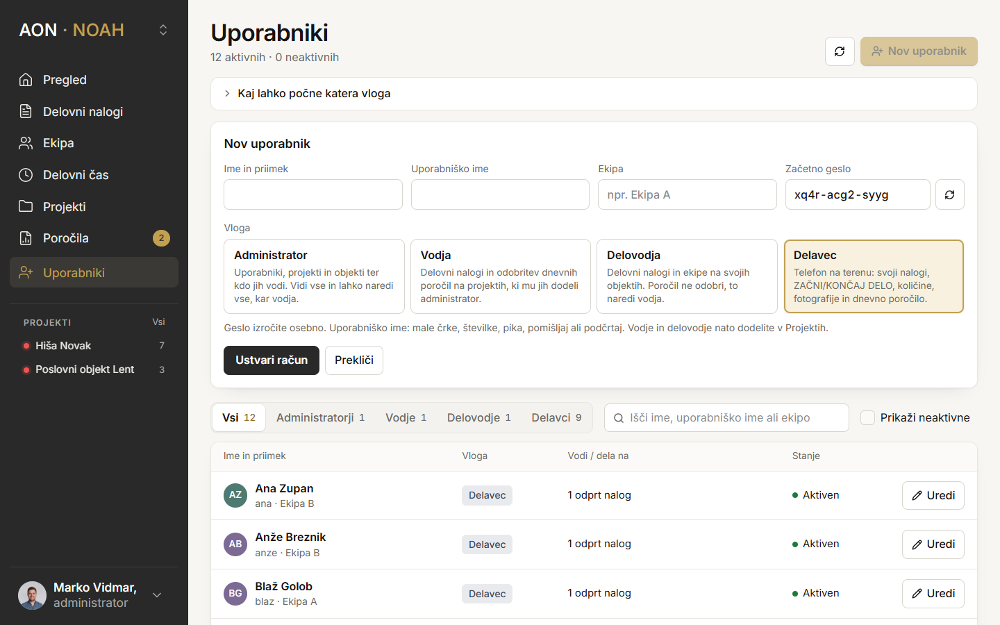

| Vloga | Kaj lahko počne | Naprava |
| --- | --- | --- |
| Administrator | Uporabniki, projekti in objekti ter vse, kar lahko vodja | Računalnik |
| Vodja | Delovni nalogi in odobritev dnevnih poročil na svojih projektih | Računalnik ali tablica |
| Delovodja | Delovni nalogi in ekipe na svojih objektih, poročil ne odobri | Računalnik ali tablica |
| Delavec | Svoji nalogi, ZAČNI/KONČAJ DELO, količine, fotografije, dnevno poročilo | Telefon |

### 2. Dodajte projekt in objekt

V meniju *Projekti* kliknite *Nov projekt* in v njem *Nov objekt*. V bazi je že nekaj testnih projektov (npr. *Hiša Novak*), ki jih lahko uporabite ali odstranite. Vodje in delovodje projektom dodelite v istem meniju.

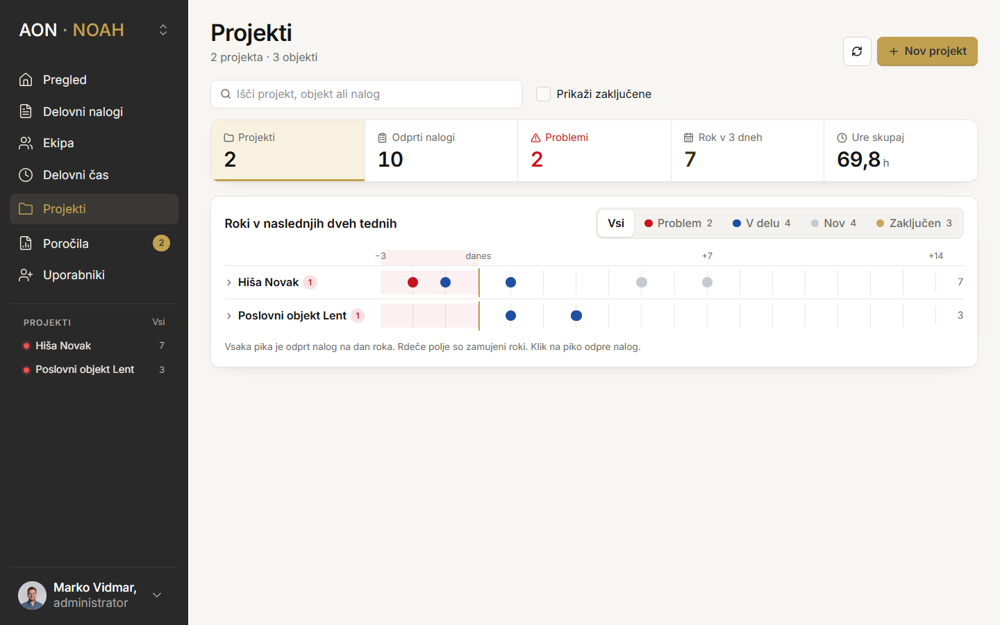

### 3. Namestite aplikacijo na telefon

Priporočam Chrome na Androidu ali Safari na iPhonu. Za prvo prijavo na napravi potrebujete povezavo, kasneje ne več.

- **Android (Chrome):** meni ⋮ → *Namesti aplikacijo* ali *Dodaj na začetni zaslon*.
- **iPhone (Safari):** gumb *Deli* → *Dodaj na začetni zaslon*.

## Preizkus za delavca (telefon)

Spodaj je delavčev dan v slikah, pod njim pa kontrolni seznam. Slike so iz testne različice z izmišljenimi podatki, zato se imena in nalogi razlikujejo od vaših.

### Potek dneva v slikah

**Prijava.** Prva prijava na napravi potrebuje povezavo, nato aplikacija deluje tudi brez nje.

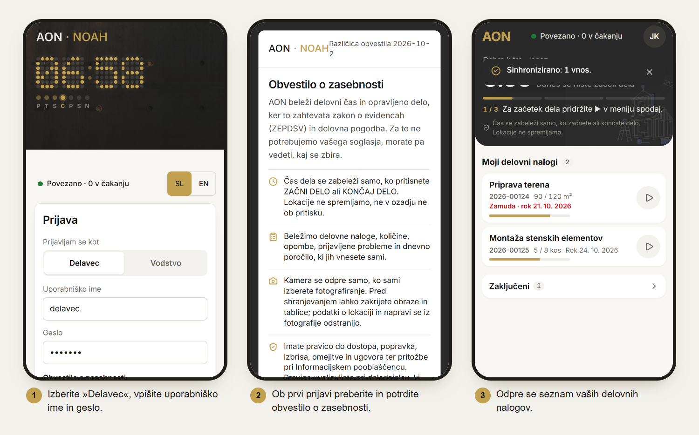

**Začetek dela.** Čas prihoda se zabeleži ob pritisku, lokacije aplikacija ne spremlja.

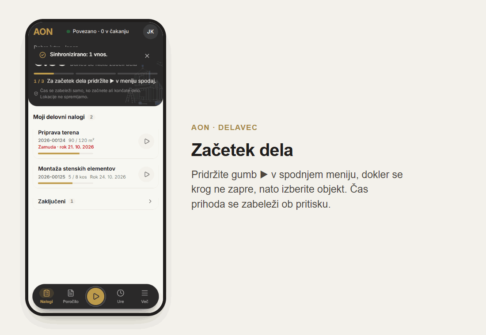

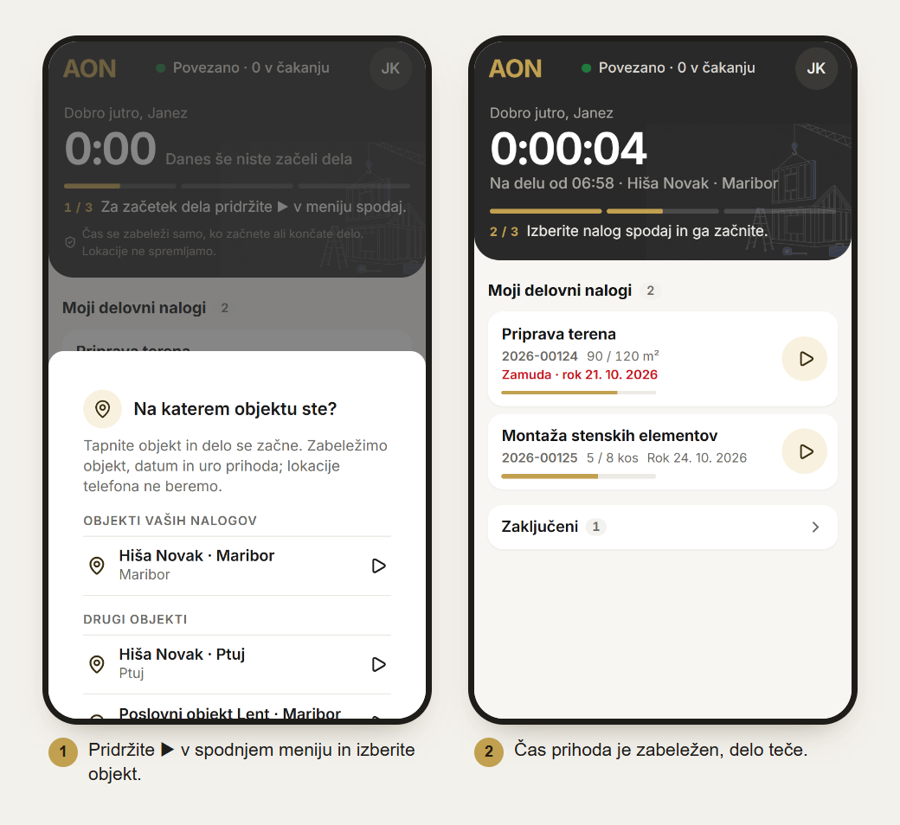

**Delo na nalogu.** Količino vpisujete sproti, fotografije pa pred shranjevanjem pregledate in zakrijete obraze ali tablice.

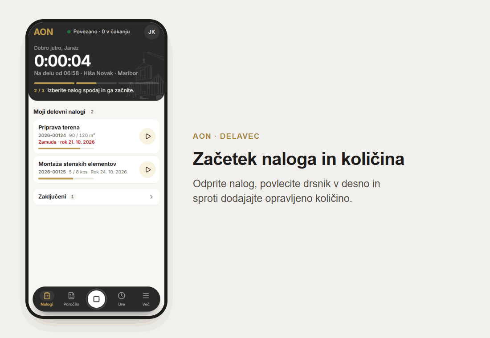

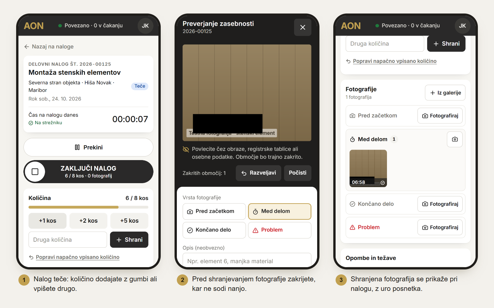

**Konec dela in poročilo.** Poročilo se sestavi iz vaših vnosov, dopolnite samo opis in komentar.

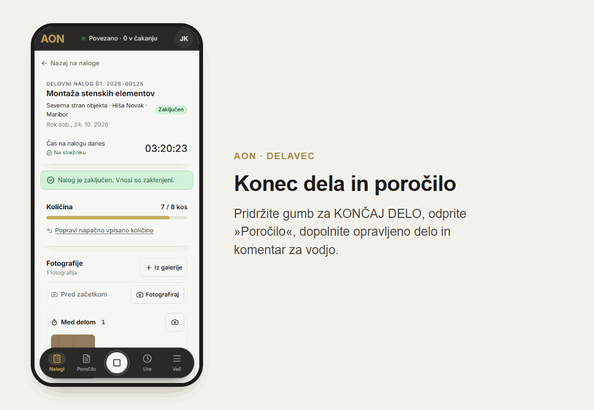

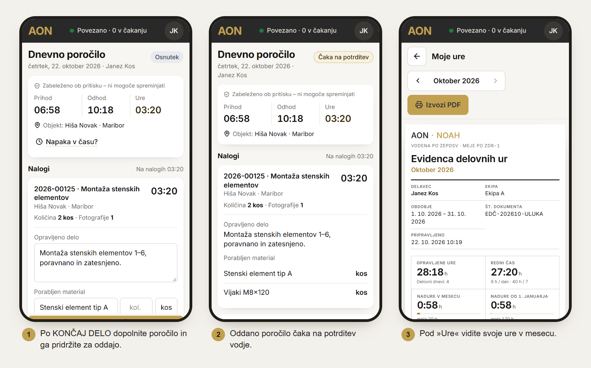

### Kontrolni seznam

Pri vsakem koraku v zadnji stolpec vpišite *Da* ali opišite, kaj se je zgodilo.

| # | Kaj naredite | Kaj se mora zgoditi | Deluje? |
| --- | --- | --- | --- |
| 1 | Prijavite se kot *Delavec*. | Odpre se zaslon *Nalogi* s seznamom vaših delovnih nalogov. | |
| 2 | V spodnjem meniju pridržite gumb ▶ (ZAČNI DELO), dokler se krog ne zapre, in izberite objekt. | Zapiše se čas prihoda, na vrhu piše *Na delu od …*. | |
| 3 | Odprite nalog in povlecite drsnik ZAČNI NALOG v desno. | Nalog dobi status *V delu*, čas na nalogu začne teči. | |
| 4 | V razdelku *Količina* tapnite gumb za hitro količino, nato vpišite še *Drugo količino*. | Količina se prišteje, vrstica napredka se posodobi. | |
| 5 | Tapnite *Popravi napačno vpisano količino*, vpišite manjšo količino in razlog. | Količina se zmanjša, popravek je viden v dnevniku naloga. | |
| 6 | Dodajte fotografijo (*Pred začetkom* ali *Med delom*). Na predogledu povlecite čez območje, ki ga želite zakriti, in shranite. | Fotografija se prikaže pri nalogu, zakrito območje je trajno prekrito. | |
| 7 | V *Opombe in težave* zapišite opombo in tapnite *Shrani opombo*. | Opomba se prikaže v dnevniku naloga. | |
| 8 | Preklopite na *Problem*, opišite težavo in tapnite *Prijavi problem*. | Nalog dobi status *Problem*, čas na njem se ustavi. | |
| 9 | Odprite drug nalog, ga začnite, vpišite količino in povlecite drsnik ZAKLJUČI NALOG. | Nalog dobi status *Zaključen*. | |
| 10 | V spodnjem meniju pridržite gumb za KONČAJ DELO. | Zapiše se čas odhoda in skupne ure dneva. | |
| 11 | Odprite *Poročilo*, dopolnite *Opravljeno delo*, *Porabljen material* in *Komentar za vodjo*, nato pridržite ODDAJ POROČILO. | Poročilo je oddano in čaka na potrditev vodje. | |
| 12 | Odprite *Ure*. | Vidite svoje ure po dnevih za tekoči mesec. | |

## Preizkus za vodjo (računalnik ali tablica)

Najbolje je, da vodja in delavec preizkušata hkrati: vodja ustvari nalog, delavec ga izvede, vodja nato pregleda in potrdi poročilo.

### Zasloni vodje

**Delovni nalogi.** Po prijavi se odpre seznam nalogov za današnji dan, s filtri po statusu, projektu in objektu.

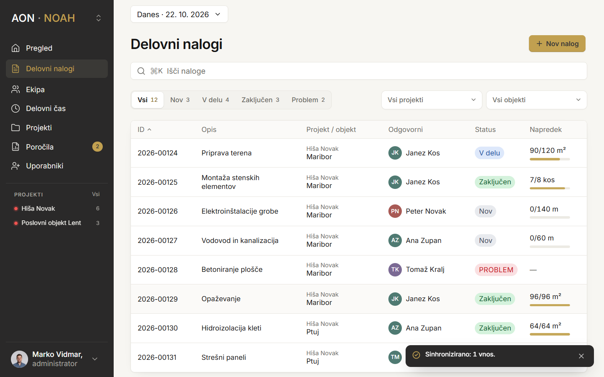

**Nov nalog.** Vodja izpolni projekt, objekt, nalogo, ekipo in plan. Desno sproti vidi, kako bo nalog videti na telefonu.

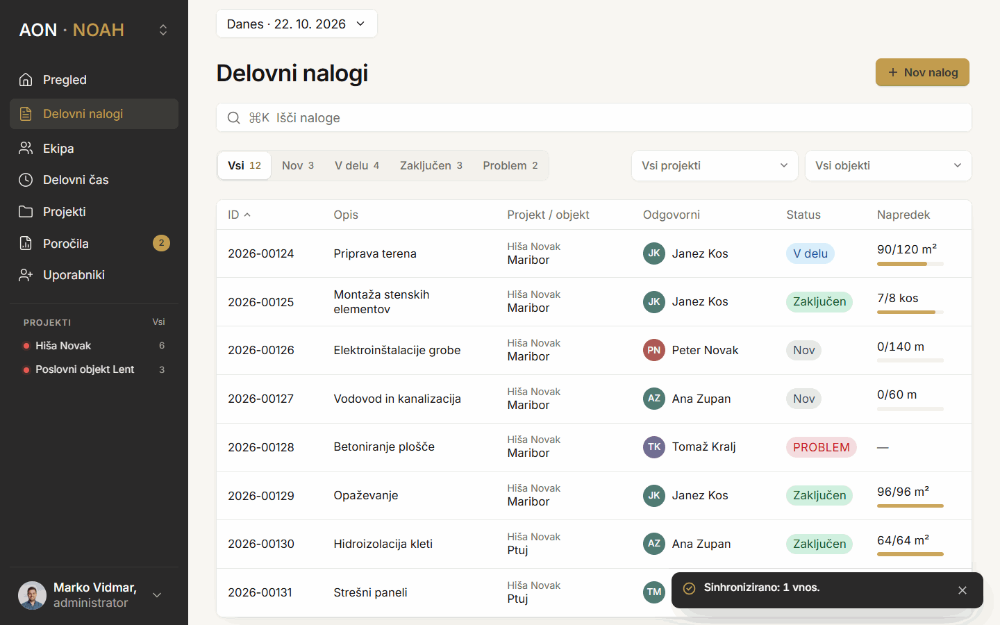

**Poročila.** Oddano poročilo pokaže prihod, odhod, čas po nalogih, opravljeno delo, material, komentar in fotografije. Vodja ga potrdi ali vrne v popravek z opombo.

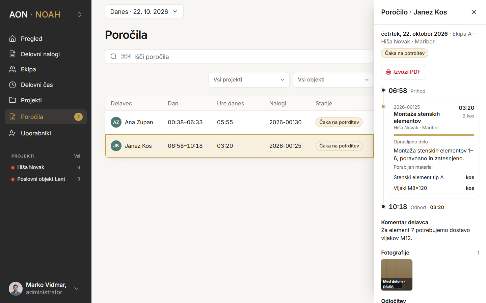

**Delovni čas in PDF.** Mesečna evidenca ur, nadur in počitka za vsakega delavca ter izvoz poročila v PDF.

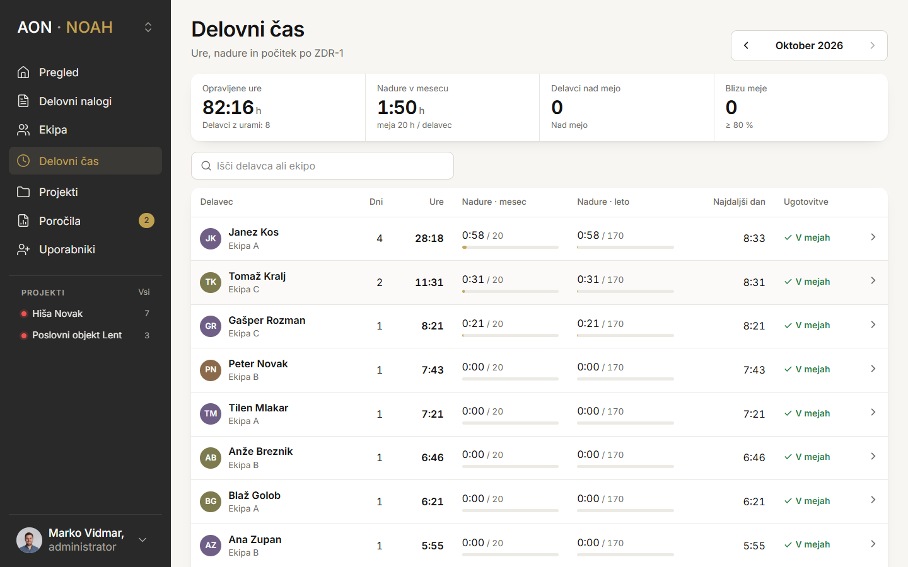

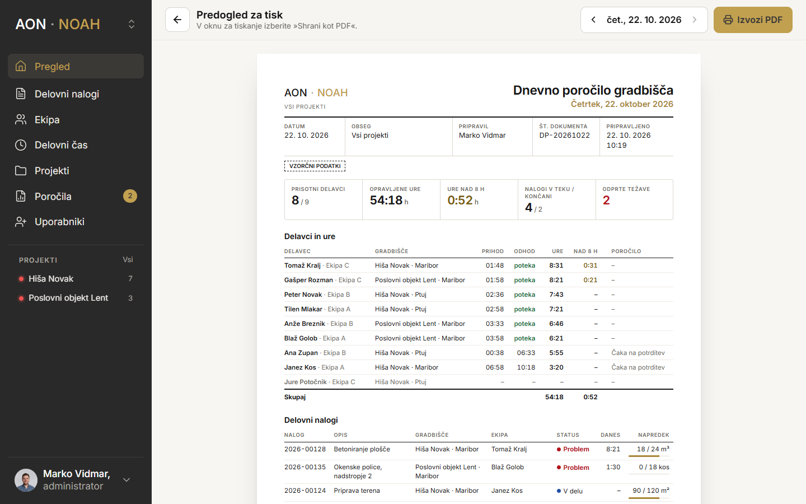

### Kontrolni seznam

| # | Kaj naredite | Kaj se mora zgoditi | Deluje? |
| --- | --- | --- | --- |
| 1 | Prijavite se kot *Vodstvo*. | Odpre se seznam *Delovni nalogi* za današnji dan. | |
| 2 | Tapnite *Nov nalog*. Izpolnite naslov, projekt, objekt, količino z enoto, ocenjen čas, rok in materiale. Izberite delavca v *Ekipa* in tapnite *Dodeli ekipi*. | Nalog je shranjen in dodeljen. Delavec ga vidi na telefonu po osvežitvi. | |
| 3 | Odprite *Delovni nalogi* in filtrirajte po projektu in objektu. | V tabeli so samo nalogi izbranega projekta in objekta. | |
| 4 | Medtem ko delavec dela, odprite *Pregled* in *Ekipa*. | Vidite, kdo je na delu, na katerem nalogu in od kdaj. | |
| 5 | Odprite nalog, na katerem je delavec delal. | Vidite količine, čas, fotografije, opombe in prijavljene težave. | |
| 6 | Ko delavec odda poročilo, odprite *Poročila* in ga tapnite *Vrni v popravek* z opombo. | Delavec vidi, da je poročilo vrnjeno, in ga lahko popravi. | |
| 7 | Ko delavec odda popravek, poročilo tapnite *Potrdi*. | Poročilo je potrjeno, zabeleženi časi ostanejo nespremenjeni. | |
| 8 | Odprite *Delovni čas* in izberite delavca. | Vidite ure, nadure in počitek po dnevih v mesecu. | |
| 9 | Tapnite *Izvozi PDF*. | Odpre se predogled za tisk, ki ga lahko shranite kot PDF. | |
| 10 | V *Projekti* dodajte nov projekt in v njem nov objekt (to lahko stori administrator ali vodja z dovoljenjem). | Projekt in objekt sta na voljo pri ustvarjanju naloga. | |

## Delo brez povezave

To je najpomembnejši del preizkusa, saj na gradbišču signala pogosto ni. Nobeden od vnosov se ne sme izgubiti.

1. Na telefonu delavca vklopite način za letalo.
2. Na vrhu se mora prikazati *Brez povezave*.
3. Začnite nalog, vpišite količino, dodajte opombo in fotografijo.
4. Ob kazalniku povezave se mora povečevati število vnosov, ki čakajo.
5. Zaprite aplikacijo in jo znova odprite. Vsi vnosi morajo biti še vedno vidni.
6. Izklopite način za letalo.
7. V nekaj sekundah se mora prikazati *0 v čakanju*. Vodja mora videti vse vnose.

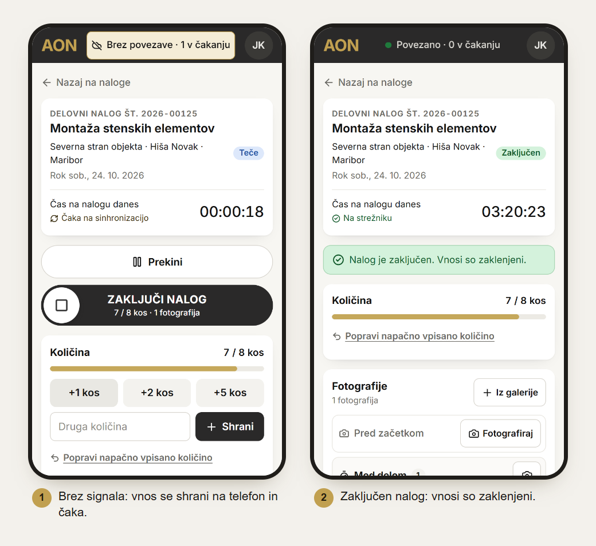

## Znane omejitve in sporočanje napak

To je testna različica, zato nekatere stvari še niso dokončne:

- Glasovni vnos (GOVORI) še ni vklopljen. Besedilo zaenkrat vpišite ročno.
- Obvestilo o zasebnosti je vzorčno in ga bo pred uporabo s pravimi podatki pregledal pravnik.
- Uporabnike, projekte in objekte ureja administrator. Vodja lahko dodaja projekte in objekte le, če ima za to dovoljenje.
- PDF se ustvari prek brskalnikovega tiskanja (*Natisni → Shrani kot PDF*).

Napake mi sporočite po e-pošti ali osebno. Za vsako napako prosim navedite:

1. vlogo (delavec ali vodja) in napravo (npr. Samsung A54, Chrome),
2. številko koraka iz tabele zgoraj,
3. kaj ste naredili in kaj se je zgodilo,
4. posnetek zaslona, če je mogoče.

Hvala za pomoč pri preizkusu.
